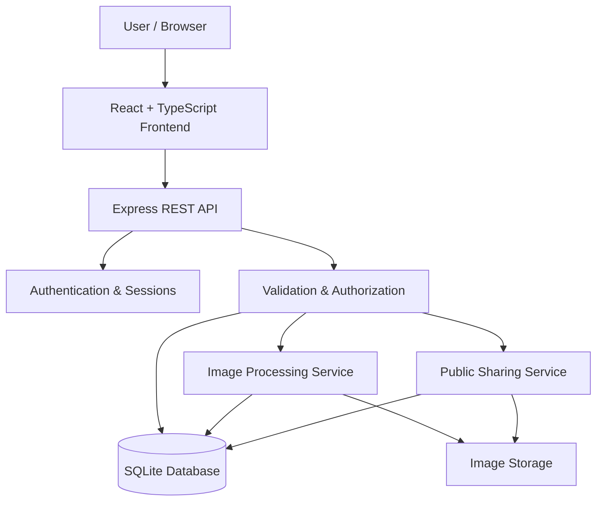
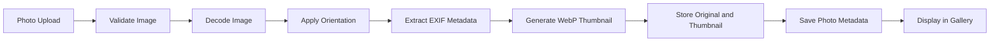
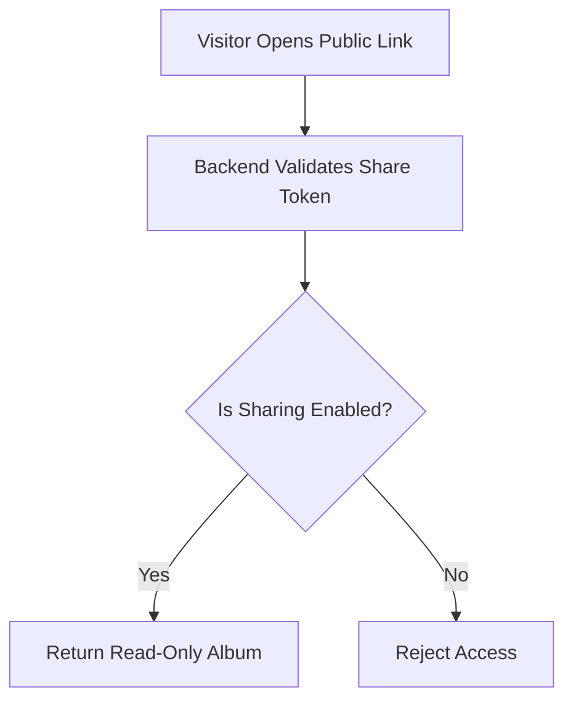

# 📸 Photo Albums

### Every memory, beautifully organized.

**A modern, full-stack photo management application to upload, organize, discover, and share your favorite memories.**

Organize photos into albums, find memories through smart tag-based search, explore your photo timeline, and share albums using secure, revocable public links.


---

## 🌐 Live Demo

🚀 **[Visit Photo Albums — Live Website](https://photo-albums-fx2n.onrender.com/)**

Explore the deployed application and try its photo album management, tagging, timeline, and sharing features.

---

## ✨ Overview

Your photos deserve more than a folder.

**Photo Albums** is a responsive, full-stack photo management platform designed to make organizing personal photo collections simple, efficient, and secure.

Users can upload multiple photos, create albums, organize images with tags, search across their collections, and share albums through public links that can be revoked whenever needed.

The application combines a modern gallery experience with practical backend engineering, including server-side image processing, EXIF metadata extraction, relational data management, authentication, and access control.

## 🌟 Key Features

| Feature | Description |
|---|---|
| 📤 Multiple Photo Uploads | Upload multiple images with drag-and-drop support and progress feedback. |
| ⚡ Automatic Thumbnails | Generate optimized WebP thumbnails on the server using Sharp. |
| 📚 Album Management | Create, rename, and delete albums; manage photos and covers. |
| 🔄 Flexible Organization | Add one photo to multiple albums without duplicating the original. |
| 🏷️ Smart Tagging | Add and remove tags to organize photos. |
| 🔎 Multi-Tag Search | Find photos matching all selected tags using AND logic. |
| 📅 EXIF-Based Sorting | Organize photos using capture dates, with upload-date fallback. |
| 🌐 Public Album Sharing | Generate read-only public links for albums. |
| 🔒 Revocable Sharing | Disable public access and reject subsequent requests. |
| 🖥️ Full-Screen Viewer | View photos with keyboard navigation, zoom, and slideshows. |
| ❤️ Favorites | Mark photos as favorites and filter your collection. |
| ☑️ Bulk Actions | Select multiple photos and perform supported actions together. |
| 📦 ZIP Downloads | Download photo collections as ZIP archives. |
| 📊 Dashboard | View photo, album, favorite, and storage statistics. |
| 🕰️ Photo Timeline | Explore photos grouped by year or month. |
| 👤 Account Management | Log in, change passwords, and sign out across devices. |
| 📱 Responsive UI | Use the application across desktop, tablet, and mobile devices. |

---

## 🛠️ Tech Stack

The project uses a modern TypeScript-based full-stack architecture.

| Layer | Technology | Purpose |
|---|---|---|
| Frontend | React, TypeScript, Vite | User interface and frontend development |
| Styling | Tailwind CSS | Responsive styling |
| Backend | Node.js, Express, TypeScript | REST API and business logic |
| Database | SQLite, better-sqlite3 | Relational data storage |
| Image Processing | Sharp | Image processing and WebP thumbnails |
| Metadata | exifr | EXIF metadata extraction |
| Validation | Zod | Request and configuration validation |
| Authentication | bcrypt, server-side sessions | Password hashing and session management |
| Testing | Vitest, Supertest | Automated backend and API testing |

---

## 🏗️ System Architecture

The application separates the frontend, backend API, database, and image storage.

### Architecture Diagram



### Request Lifecycle

1. The user interacts with the React frontend.
2. The frontend sends requests to the Express API.
3. The backend authenticates the session and validates incoming requests.
4. Authorization checks enforce album ownership and access restrictions.
5. Application services process requests and interact with SQLite or image storage.
6. The backend returns the appropriate response.

**Core principle:** Security-sensitive operations, including authentication, ownership checks, image processing, and public-link authorization, are handled on the backend.

---

## 🖼️ Image Processing Pipeline

Photo uploads are processed on the server before being displayed in the gallery.



### Why WebP Thumbnails?

Loading full-resolution images for every gallery tile wastes bandwidth and increases memory usage.

The application generates smaller WebP thumbnails during upload and uses them in gallery views. The original image remains available when users open or download a photo.

### EXIF-Based Sorting

Photo sorting follows this process:

1. Extract the capture date from valid EXIF metadata when available.
2. Fall back to the upload timestamp when EXIF data is unavailable.
3. Store the relevant timestamps in the database.
4. Use the selected date for chronological sorting and timeline grouping.

This helps organize photos from different devices and upload sessions chronologically.

---

## 🔒 Security & Privacy

Security is an important part of the application's backend architecture.

| Security Area | Implementation |
|---|---|
| Authentication | Server-side session management |
| Password Security | bcrypt password hashing |
| Session Management | HTTP-only cookies |
| Authorization | Ownership checks for private albums and photos |
| Input Validation | Server-side validation using Zod |
| Image Validation | Validate image content rather than trusting filenames |
| Public Sharing | Random, unguessable sharing tokens |
| Link Revocation | Check the current sharing state on the server |
| Shared Content | Protect shared images and downloads with authorization checks |
| Database Integrity | Relational constraints and foreign keys |
| Production | HTTPS and secure-cookie configuration where required |

### How Public Sharing Works



Public sharing is designed to provide read-only access without exposing private album management functionality.

When sharing is disabled, subsequent backend requests for shared content must be rejected. The same authorization policy applies to album metadata, thumbnails, original images, and ZIP downloads.

---

## 🧪 Testing

The project's recorded test results show:

- **82 automated tests passed**
- **6 test files**
- **Vitest and Supertest**

### Testing Coverage

- Album creation and management
- Photo uploads and image validation
- Thumbnail generation
- Tag management and multi-tag search
- Authentication and session handling
- Ownership and authorization checks
- Public album sharing
- Share-link revocation
- Image access and ZIP downloads
- API validation and error handling

### Run Tests Locally

```bash
cd backend
npm install
npm test
```

Run the test suite after modifying authentication, routes, image processing, album operations, or sharing functionality.

---

## ⚙️ Getting Started

Follow these steps to run the project locally.

### Prerequisites

Make sure you have installed:

- Node.js 20 or newer
- npm
- Git

SQLite is used as the local database, so a separate database server is not required.

### 1. Clone the Repository

```bash
git clone https://github.com/ankitsingyadav/photo-albums.git

cd photo-albums
```

### 2. Configure the Backend

```bash
cd backend

npm install
```

Create your environment file from the example.

**Windows PowerShell:**

```powershell
Copy-Item .env.example .env
```

**macOS / Linux:**

```bash
cp .env.example .env
```

Review the `.env` file and configure the required environment variables.

### 3. Seed Demo Data

```bash
npm run seed
```

The seed script prepares sample users, albums, photos, favorites, and a public shared album according to its implementation.

> **Important:** The seed command resets demo data. Use it only when resetting the local demo environment is acceptable.

### 4. Start the Backend

```bash
npm run dev
```

The backend API runs at:

```text
http://localhost:4000
```

Keep this terminal running.

### 5. Start the Frontend

Open a second terminal from the project root.

```bash
cd frontend

npm install

npm run dev
```

Open the local URL printed by Vite, usually:

```text
http://localhost:5173
```

Your application is now ready to use!

---

## 👤 Demo Accounts

The local development environment includes two demo accounts.

| Account | Email | Password |
|---|---|---|
| Demo User | `demo@example.com` | `password123` |
| Guest User | `guest@example.com` | `password123` |

The seed environment includes sample photos, albums, favorites, and a pre-shared album.

**Security Notice:** These credentials are intended for local development only. Do not use these demo passwords for production accounts.

---

## 📷 Add Your Own Photos

You can add your own supported images to the demo environment.

1. Create the `backend/my-photos/` directory.
2. Add JPEG, PNG, or WebP images.
3. Run the seed command from the backend directory.

```bash
npm run seed
```

The seed script imports the images into the demo account according to its implementation.

Remember that seeding resets demo data. Back up anything important before running it again.

---

## 🗃️ Database Design

The relational database stores account information, photo metadata, albums, tags, and their relationships.

| Table | Responsibility |
|---|---|
| `users` | User accounts and password hashes |
| `photos` | Photo ownership, file information, dimensions, and timestamps |
| `albums` | Album metadata, cover selection, and sharing state |
| `album_photos` | Many-to-many relationship between albums and photos |
| `tags` | Tags associated with users |
| `photo_tags` | Many-to-many relationship between photos and tags |

### Key Design Decisions

- **Separate metadata and files:** Image files live in storage, while SQLite stores their metadata and paths.
- **Many-to-many relationships:** A photo can belong to multiple albums and have multiple tags.
- **Ownership-aware queries:** Private resources are scoped to their owners.
- **Independent sharing controls:** Public access is controlled through a share token and the album's current sharing state.
- **Capture dates and upload dates:** Both timestamps can be preserved for reliable sorting and fallback behavior.

---

## 📁 Project Structure

```text
photo-albums/
│
├── backend/
│   ├── src/
│   │   ├── app.ts
│   │   ├── config.ts
│   │   ├── db.ts
│   │   ├── images.ts
│   │   ├── storage.ts
│   │   ├── tags.ts
│   │   ├── photos.ts
│   │   ├── routes/
│   │   ├── seed.ts
│   │   └── devImages.ts
│   │
│   ├── tests/
│   ├── seed-photos/
│   ├── .env.example
│   └── package.json
│
├── frontend/
│   ├── src/
│   │   ├── pages/
│   │   ├── Lightbox/
│   │   ├── PhotoGrid/
│   │   ├── Upload/
│   │   └── ...
│   │
│   └── package.json
│
└── README.md
```

This is a high-level representation. Consult the source files for the exact implementation and available routes.

---

## 🚀 Production Build

The backend can serve the built frontend as well as the API when configured for production.

### Build the Frontend

```bash
cd frontend

npm run build
```

### Start the Backend in Production Mode

```bash
cd ../backend

NODE_ENV=production npm start
```

**Windows PowerShell:**

```powershell
$env:NODE_ENV = "production"

npm start
```

The application runs on one port when the backend is configured to serve the frontend build.

### Production Considerations

- Serve the application over HTTPS.
- Enable secure cookies in production.
- Configure trusted proxies according to the deployment environment.
- Keep secrets out of Git.
- Never run the demo seed command in production.
- Configure persistent image storage and a persistent database location.
- Verify that public sharing and image downloads enforce authorization on every request.

> **Deployment Note:** SQLite and disk-based image storage require persistent storage in production. An ephemeral filesystem can result in lost data. Configure suitable persistent storage before deploying.

---

## 🧠 AI-Assisted Development

AI tools were used as development assistants throughout the project to support implementation, debugging, testing, and documentation.

### Areas of AI Assistance

| Area | Assistance |
|---|---|
| Architecture | Understanding requirements and planning application components |
| Development | Exploring implementation approaches and troubleshooting coding issues |
| Debugging | Interpreting errors and investigating unexpected behavior |
| Testing | Reviewing test scenarios and understanding test failures |
| Code Quality | Improving readability and identifying areas requiring further review |
| Documentation | Organizing the README and explaining technical decisions |

### Engineering Responsibility

AI assistance does not replace understanding or verification. Implementation decisions, test results, and security-sensitive behavior must be reviewed against the actual source code.

The project's automated tests and manual checks help validate important functionality, particularly public album access and share-link revocation.

---

## 🔮 Future Improvements

Potential improvements for future versions include:

- ☁️ Cloud or S3-compatible object storage
- ⚡ Streaming uploads and background image processing
- 📱 HEIC and additional image-format support
- 📧 Email-based account recovery
- 🧪 End-to-end frontend testing
- 🖼️ Multiple thumbnail sizes and responsive image delivery
- 🔍 More advanced photo search and filtering
- ♿ Accessibility improvements and additional keyboard navigation
- 📈 Performance monitoring and operational logging

---

## 📜 Sample Image Licensing

Bundled demo photos are derived from demo assets associated with the open-source lightGallery project.

Review the applicable license and attribution requirements before redistributing these assets or using them commercially. Replace demo images with assets you have permission to use when appropriate.

---


## 📸 Photo Albums

### Organize your photos. Rediscover your memories. Share them securely.

**Built with React, TypeScript, Node.js, Express, SQLite, and Sharp.**


⭐ If you find this project useful, consider giving the repository a star!

</div>
