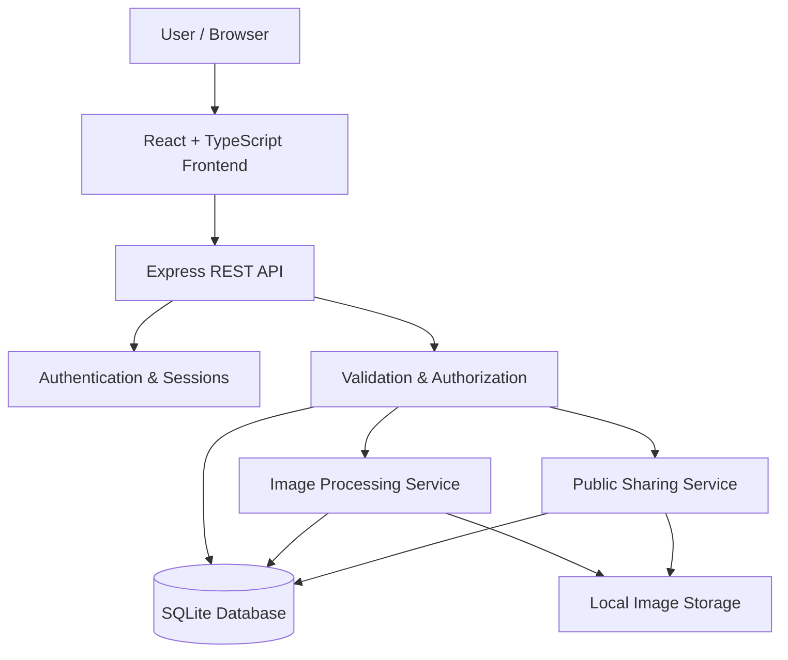
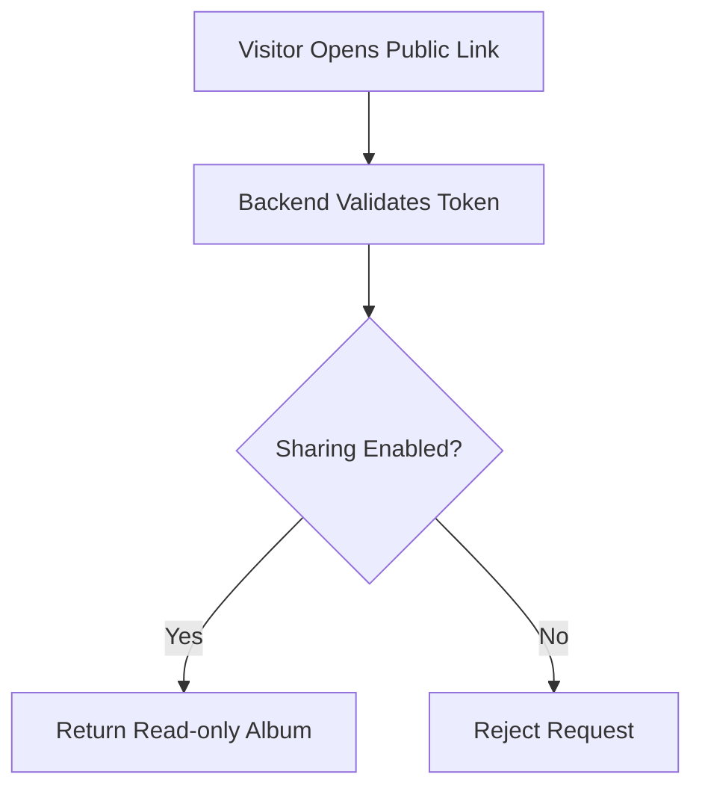

\<div align="center">

# 📸 Photo Albums

### Every memory, beautifully organized.

**A modern, full-stack photo management application to upload, organize, discover, and share your favorite memories.**

Organize photos into albums, find memories through smart tag-based search, explore your photo timeline, and share albums using secure, revocable public links.

\<br/>


\<br/>

**📂 [Explore the Repository](#-getting-started) · 🧪 [Testing](#-testing) · 🏗️ [Architecture](#️-architecture)**

\</div>

---

## ✨ Overview

Your photos deserve more than a folder.

**Photo Albums** is a responsive, full-stack photo management platform built to make organizing personal photo collections simple, efficient, and secure.

Upload multiple images, create collections, add meaningful tags, search across your library, and share albums with anyone through public links that you can revoke at any time.

From automatic thumbnail generation to EXIF-based photo timelines, the application combines a polished gallery experience with practical backend engineering.

### 🌟 Highlights

- 🖼️ **Efficient galleries** — Server-generated WebP thumbnails keep gallery views lightweight.
- 📚 **Flexible albums** — Organize photos into multiple collections without duplicating originals.
- 🏷️ **Powerful tag search** — Combine tags using AND logic to find precisely the photos you need.
- 🕒 **Photo timelines** — Sort and group memories using capture dates extracted from EXIF metadata.
- 🔗 **Revocable sharing** — Share read-only albums and disable access immediately.
- 🔐 **Security-conscious design** — Server-side sessions, password hashing, input validation, and ownership checks.
- 📱 **Responsive experience** — Browse and manage your library on phones, tablets, and desktops.

---

## 🚀 Features

| Feature                  | Description                                                             |
| ------------------------ | ----------------------------------------------------------------------- |
| 📤 Multi-photo uploads   | Upload several photos with drag-and-drop support and progress feedback. |
| ⚡ Automatic thumbnails   | Generate optimized WebP thumbnails on the server.                       |
| 🗂️ Album management     | Create, rename, and delete albums; manage photos and cover images.      |
| 🔄 Flexible organization | Add one photo to multiple albums without duplicating its original file. |
| 🏷️ Tag management       | Add and remove tags from photos.                                        |
| 🔎 Multi-tag search      | Find photos matching every selected tag using AND logic.                |
| 📅 EXIF-based sorting    | Use the date captured, falling back to the upload timestamp.            |
| 🌐 Public album links    | Generate read-only links for sharing collections.                       |
| ⛔ Instant revocation     | Disable sharing and reject subsequent requests for shared content.      |
| 🖥️ Full-screen viewer   | Navigate photos using keyboard controls, zoom, and run slideshows.      |
| ❤️ Favorites             | Mark favorite photos and filter your collection.                        |
| ☑️ Bulk actions          | Select multiple photos and perform supported actions together.          |
| 📦 ZIP downloads         | Download photo collections as ZIP archives, including shared albums.    |
| 📊 Library dashboard     | View photo, album, favorite, and storage counts.                        |
| 🕰️ Timeline view        | Explore photos grouped by year or month.                                |
| 👤 Account management    | Log in, change passwords, and sign out across devices.                  |
| 📲 Mobile-friendly UI    | Enjoy a responsive interface across different screen sizes.             |

---

## 🛠️ Tech Stack

Built with a modern TypeScript-based stack.

\<table>
\<tr>
\<th>Layer\</th>
\<th>Technology\</th>
\<th>Purpose\</th>
\</tr>
\<tr>
\<td>\<b>Frontend\</b>\</td>
\<td>React, TypeScript, Vite\</td>
\<td>Responsive user interface and fast development.\</td>
\</tr>
\<tr>
\<td>\<b>Styling\</b>\</td>
\<td>Tailwind CSS\</td>
\<td>Consistent, responsive UI styling.\</td>
\</tr>
\<tr>
\<td>\<b>Backend\</b>\</td>
\<td>Node.js, Express, TypeScript\</td>
\<td>API endpoints, business logic, and access control.\</td>
\</tr>
\<tr>
\<td>\<b>Database\</b>\</td>
\<td>SQLite, better-sqlite3\</td>
\<td>Persistent relational data storage.\</td>
\</tr>
\<tr>
\<td>\<b>Image processing\</b>\</td>
\<td>Sharp\</td>
\<td>Image decoding, resizing, and thumbnail generation.\</td>
\</tr>
\<tr>
\<td>\<b>Metadata\</b>\</td>
\<td>exifr\</td>
\<td>Extract photo capture dates from EXIF metadata.\</td>
\</tr>
\<tr>
\<td>\<b>Validation\</b>\</td>
\<td>Zod\</td>
\<td>Validate incoming requests and configuration.\</td>
\</tr>
\<tr>
\<td>\<b>Authentication\</b>\</td>
\<td>Server-side sessions, HTTP-only cookies, bcrypt\</td>
\<td>Session-based authentication and password hashing.\</td>
\</tr>
\<tr>
\<td>\<b>Testing\</b>\</td>
\<td>Vitest, Supertest\</td>
\<td>Automated backend and API testing.\</td>
\</tr>
\</table>

---

## 🏗️ Architecture

The application separates the frontend, API logic, relational data, and image storage.



### Request lifecycle

1. A user interacts with the React frontend.
2. The frontend sends a request to the Express API.
3. The backend authenticates the session and validates the request.
4. Authorization checks enforce ownership and access restrictions.
5. Application services process the request and interact with SQLite or image storage.
6. The backend returns the appropriate response to the frontend.

**Design principle:** Critical operations such as image processing, album ownership, and public-link authorization are enforced by the backend rather than trusted to the client.

---

## 🖼️ Image Processing Pipeline

Photo uploads are processed on the server before the gallery uses them.


### Why generate thumbnails?

Loading full-resolution originals for every gallery tile wastes bandwidth and increases memory usage.

Photo Albums generates smaller thumbnails during upload and serves those thumbnails in gallery views. The original remains available when a user opens or downloads a photo.

### Capture-date handling

Photo sorting follows this rule:

1. Extract the capture date from valid EXIF metadata when available.
2. Otherwise, use the upload timestamp.
3. Store the relevant timestamps in the database.
4. Use the selected date for chronological sorting and timeline grouping.

This allows photos from different devices and upload sessions to appear in a meaningful chronological order.

---

## 🔒 Security & Privacy

Security is built into the backend's design.

| Area                     | Implementation                                                         |
| ------------------------ | ---------------------------------------------------------------------- |
| Authentication           | Server-side sessions identified by HTTP-only cookies.                  |
| Password security        | bcrypt password hashing.                                               |
| Authorization            | Ownership checks for private albums and photos.                        |
| Input validation         | Server-side validation using Zod.                                      |
| Image validation         | Validate and decode image content instead of trusting filenames alone. |
| Public sharing           | Random, unguessable sharing tokens.                                    |
| Link revocation          | Check current sharing state on the server for public requests.         |
| Shared image access      | Recheck authorization for shared album content and downloads.          |
| Database integrity       | Foreign-key relationships maintain consistency between records.        |
| Production configuration | HTTPS and secure-cookie settings where required.                       |

### 🔗 How revocable sharing works



Disabling a share link must prevent subsequent access through the backend. The frontend cannot revoke access merely by hiding the link.

The same authorization policy must protect album metadata, thumbnails, full-resolution images, and ZIP downloads.

---

## 🧪 Testing

**82 automated tests passed across 6 test files**, according to the project's recorded test results.

The backend test suite uses Vitest and Supertest to validate important application behavior.

### Coverage areas

- **Album management:** Album creation and photo organization.
- **Photo processing:** Upload validation, image handling, and thumbnail generation.
- **Tags and search:** Tag associations and multi-tag filtering.
- **Authentication and authorization:** Session handling and ownership restrictions.
- **Public sharing:** Access to shared albums, images, and ZIP downloads.
- **Link revocation:** Blocking access after sharing is disabled or expires.
- **API validation:** Rejecting malformed tokens and invalid or unauthorized requests.

### Run the tests

```bash
cd backend
npm install
npm test
```

Run the suite after modifying routes, authentication, image processing, album operations, or sharing behavior.

> Test count reflects the project's documented test run. Run the test suite again against the submitted code to verify the current result.

---

## ⚙️ Getting Started

Run the application locally in a few steps.

### Prerequisites

- Node.js 20 or newer
- npm
- Git

No separate database server is required. SQLite is stored in a local database file.

### 1. Clone the repository

```bash
git clone https://github.com/ankitsingyadav/photo-albums.git
cd photo-albums
```

### 2. Configure the backend

```bash
cd backend
npm install
```

Create your local environment file by copying the example.

**Windows PowerShell:**

```powershell
Copy-Item .env.example .env
```

**macOS / Linux:**

```bash
cp .env.example .env
```

Review `.env` and adjust any settings that require customization.

### 3. Seed the demo data

```bash
npm run seed
```

This prepares sample users, albums, photos, favorites, and a public shared album according to the seed script's behavior.

**Important:** Seeding resets demo data. Use it only when resetting the local demo environment is acceptable.

### 4. Start the backend

```bash
npm run dev
```

The API runs at:

```text
http://localhost:4000
```

Keep this terminal running.

### 5. Start the frontend

Open a second terminal from the project root:

```bash
cd frontend
npm install
npm run dev
```

Open the local URL printed by Vite, usually:

```text
http://localhost:5173
```

You're ready to explore the application!

---

## 👤 Demo Accounts

Use either development account to explore the application.

| Account    | Email               | Password      |
| ---------- | ------------------- | ------------- |
| Demo user  | `demo@example.com`  | `password123` |
| Guest user | `guest@example.com` | `password123` |

The demo environment includes sample photos, albums, favorites, and a pre-shared album. The seed command prints the public link for the shared album.

**Security notice:** These credentials are for local development only. Never use public demo passwords for production accounts.

---

## 📷 Add Your Own Photos

You can add your own supported images to the demo environment.

1. Create the `backend/my-photos/` directory.
2. Add JPEG, PNG, or WebP images.
3. Run the seed command from the backend directory.

```bash
npm run seed
```

The seed script imports the images into the demo account according to its implementation.

Remember that seeding resets demo data. Back up anything important before running it again.

---

## 🗃️ Data Model

The relational database stores account information, photo metadata, albums, tags, and their relationships.

| Table          | Responsibility                                           |
| -------------- | -------------------------------------------------------- |
| `users`        | User accounts and password hashes.                       |
| `photos`       | Ownership, file information, dimensions, and timestamps. |
| `albums`       | Album metadata, cover selection, and sharing state.      |
| `album_photos` | Many-to-many relationship between albums and photos.     |
| `tags`         | Tags associated with a user.                             |
| `photo_tags`   | Many-to-many relationship between photos and tags.       |

### Key design decisions

- **Separate metadata and files:** Image files live in storage; SQLite stores their metadata and paths.
- **Many-to-many relationships:** A photo can belong to multiple albums and have multiple tags.
- **Ownership-aware queries:** Private resources are scoped to their owners.
- **Independent sharing controls:** Public access is controlled by a share token and the album's current sharing state.
- **Capture dates and upload dates:** Both timestamps can be preserved for reliable sorting and fallback behavior.

---

## 📁 Project Structure

```text
photo-albums/
│
├── backend/
│   ├── src/
│   │   ├── app.ts
│   │   ├── config.ts
│   │   ├── db.ts
│   │   ├── images.ts
│   │   ├── storage.ts
│   │   ├── tags.ts
│   │   ├── photos.ts
│   │   ├── routes/
│   │   ├── seed.ts
│   │   └── devImages.ts
│   │
│   ├── tests/
│   ├── seed-photos/
│   ├── .env.example
│   └── package.json
│
├── frontend/
│   ├── src/
│   │   ├── pages/
│   │   ├── Lightbox/
│   │   ├── PhotoGrid/
│   │   ├── Upload/
│   │   └── ...
│   └── package.json
│
└── README.md
```

This is a high-level representation. Consult the source files for the exact implementation and available routes.

---

## 🚀 Production Build

The backend can serve the built frontend as well as the API when configured for production.

### Build the frontend

```bash
cd frontend
npm run build
```

### Start the backend in production mode

```bash
cd ../backend
NODE_ENV=production npm start
```

For Windows PowerShell, set the environment variable using:

```powershell
$env:NODE_ENV = "production"
npm start
```

The application runs on one port when the backend is configured to serve the frontend build.

### Production considerations

- Serve the application over HTTPS.
- Enable secure cookies in production.
- Configure trusted proxies only for the actual deployment topology.
- Keep secrets out of Git.
- Never run the demo seed command in production.
- Configure persistent image storage and a persistent database location.
- Verify that public sharing and image downloads enforce authorization on every request.

**Deployment note:** Local SQLite and disk-based image storage require appropriate persistent storage in production. Hosting the application on an ephemeral serverless filesystem without a persistence strategy can result in lost data. Configure suitable persistent storage before deploying.

---

## 🧠 AI-Assisted Development

AI tools were used as development assistants throughout the project to support implementation, debugging, testing, and documentation.

### How AI contributed

| Area          | Assistance                                                             |
| ------------- | ---------------------------------------------------------------------- |
| Architecture  | Understanding requirements and planning application components.        |
| Development   | Exploring implementation approaches and troubleshooting coding issues. |
| Debugging     | Interpreting errors and investigating unexpected behavior.             |
| Testing       | Reviewing test scenarios and understanding test failures.              |
| Code quality  | Improving readability and identifying areas requiring further review.  |
| Documentation | Organizing the README and explaining technical decisions.              |

### Engineering responsibility

AI assistance does not replace understanding or verification. Implementation decisions, test results, and security-sensitive behavior must be reviewed against the actual source code.

The project's automated tests and manual checks help validate critical functionality, particularly public album access and share-link revocation.

---

## 🔮 Future Improvements

The application can be extended with additional capabilities:

- ☁️ Cloud or S3-compatible object storage.
- ⚡ Streaming uploads and background image processing.
- 📱 HEIC and additional image-format support.
- 📧 Email-based account recovery.
- 🧪 End-to-end frontend testing.
- 🖼️ Multiple thumbnail sizes and responsive image delivery.
- 🔍 More advanced photo search and filtering.
- 🌐 Production deployment with persistent storage.
- ♿ Accessibility improvements and additional keyboard navigation.
- 📈 Performance monitoring and operational logging.

---

## 📜 Sample Image Licensing

Bundled demo photos are derived from demo assets associated with the open-source lightGallery project.

Review the applicable license and attribution requirements before redistributing these assets or using them commercially. Replace the demo images with assets you have permission to use when appropriate.

---

\<div align="center">

## 📸 Photo Albums

**Organize your photos. Rediscover your memories. Share them securely.**

Built with React, TypeScript, Node.js, Express, SQLite, and Sharp.

\<br/>

⭐ If you find this project useful, consider giving the repository a star!

\</div>
